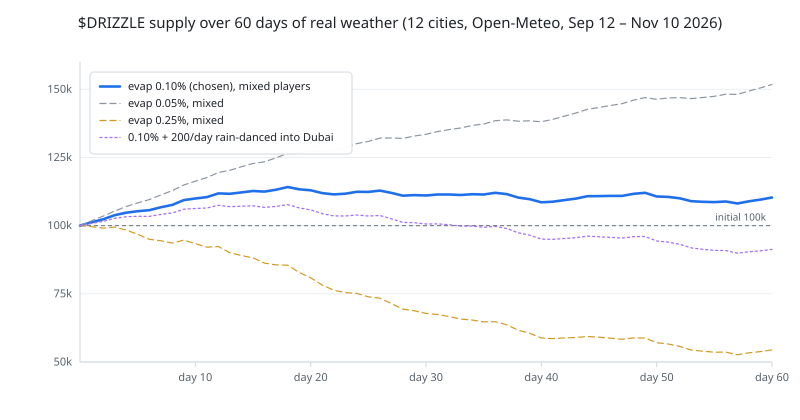

# Drizzle ($DRIZZLE): the memecoin printed by the sky ☔

A NEP-141 token whose supply mints only when it rains in real cities. The weather is read inside an Intel TDX enclave on OutLayer and delivered to the contract on-chain. After deploy the contract account has no keys, so nobody can fake a rainy hour or change the rules, including the author.

**Testnet only** · **Keyless contract** · **TEE-attested oracle**



## Try it in 2 minutes (testnet, no funds)

The demo uses the replay instance `drizzle-replay.testnet` (1 round = 60 s, looping a real week of historical weather). The live instance is `drizzle-live.testnet` (1 round = 1 real hour). Testnet NEAR is free from the faucet and the seed is never bought; a first claim attaches a 0.03199 NEAR storage bond, refunded by `storage_unregister` except the small retained seed entry.

1. Open https://drizzle-wine.vercel.app → you see 12 city pins and a "next round in mm:ss" bar.
2. Connect a testnet wallet → your account id and balance appear in the header.
3. Click **Claim seed** → you see 100 DRIZZLE (once per account).
4. Pick a city with rain in the forecast → **Plant 50** → your position shows "sprouting · after round N".
5. Wait one round (60 s) → the feed shows "<city> N mm → +X DRIZZLE to planters" and "K cities dry → 0.10% evaporated"; your stake and shares change.
6. Click **Verify** on a settled round → the drawer compares the on-chain `mm_tenths` with the same hour re-fetched from Open-Meteo in your browser and shows ✅ when all 12 match. It also shows the OutLayer request id. Because the jobs API is CORS-blocked from a static page (see [Trust model](#trust-model-and-known-limits)), resolve that id to a job id with the `curl` there and open `https://app.outlayer.ai/attestation/<job_id>?network=testnet`; for the recorded round it is https://app.outlayer.ai/attestation/57705?network=testnet, whose **Executed binary** is `7d708ee751d708e8bfd331785204190e1741ed1ca0ce5f76dcf4317e75a7128b`, the hash pinned in the contract.
7. Prove there is no admin key:

   ```bash
   near account list-keys drizzle-replay.testnet network-config testnet now
   ```

   → the list is empty.

## The mechanic

12 cities in a fixed order: Bergen, São Paulo, Lagos, Singapore, Tokyo, Jakarta, Mumbai, London, Lisbon, Seattle, Cairo, Dubai.

| Verb | What happens | Why it exists |
|---|---|---|
| **Claim seed** | Each NEAR account claims 100 $DRIZZLE once, ever | Bootstraps the game |
| **Plant** | Stake at least 1 $DRIZZLE in a city; it sprouts at the next round. A plant that would mint under 10⁶ shares at the worst-case post-rain price is rejected | Anti-snipe plus anti share-inflation: you cannot plant after seeing rain, or buy in at an absurd share price |
| **Rain** | Each round's emission E = 100 is split across cities that rained (≥ 0.2 mm), weighted by `min(mm, 5.0)`; each city's slice is split pro rata by shares | Crowded wet cities pay little, empty ones pay a lot |
| **Evaporate** | In a dry round a city's planted value loses 10 bps, burned | Supply sink: holding a dry bet costs you |
| **Rain dance** | Burn $DRIZZLE into a city's cloud jackpot; it pays that city's planters the next time it rains | The on-chain ritual; Dubai and Cairo got no rain in 60 days |
| **Uproot** | Withdraw your stake at its current value. A partial uproot must leave at least 1 $DRIZZLE, or everything | No lockup; moving costs the next round's sprout delay |
| **Tick** | Anyone can settle the due round; the caller requests the reading and earns the 1 $DRIZZLE tip | No privileged keeper |

**Anti-snipe rule:** planted tokens enter `pending` and only become shares after the next round settles, at the post-settlement price. **Live close window:** in live mode, `plant` and `uproot` freeze once the round's hour has closed until it settles, so nobody can dodge (or enter ahead of) the evaporation after the weather is public; replay is exempt because its hours are historical. **Crowding:** the round's 100 DRIZZLE is split across rainy cities by `min(mm, 5.0)`; each city's slice is split pro rata by shares. A lone planter in a wet city takes the whole slice; a hundred planters split it.

## Parameters (immutable, from `get_config`)

| Parameter | Value |
|---|---|
| `emission_per_round` | 100 DRIZZLE per round |
| `evap_bps` | 10 bps (0.10%) of a city's pool value per dry round, burned |
| `rain_threshold_tenths` | 2 tenths = 0.2 mm |
| `cap_tenths` | 50 tenths = 5.0 mm (heavier rain adds no weight) |
| `seed_amount` | 100 DRIZZLE, once per account, ever (unregistering does not reset it) |
| `keeper_tip` | 1 DRIZZLE per settled round |
| `round_seconds` | 60 s replay · 3600 s live |
| `first_hour` (replay) | 497280 = 2026-09-24T00:00Z |
| `replay_hours` | 168 (replay loops 2026-09-24T00:00Z … 09-30T23:00Z; round `r` reads `first_hour + r % replay_hours`; 0 = live) |
| `decimals` | 18 |
| `cities` | 12, fixed in `new()` |
| Oracle code | `WasmUrl` pinned by sha256 `7d708ee751d708e8bfd331785204190e1741ed1ca0ce5f76dcf4317e75a7128b`, target `wasm32-wasip2` |
| Oracle deposit / limits | 0.01 NEAR · 5·10⁹ instructions / 64 MB / 20 s |

Everything is set in `new()` and returned by `get_config()`; there are no setters. Full method, view and event shapes: [docs/interface.md](docs/interface.md).

## Simulation on real weather

[sim.py](sim.py) replays 1,440 real hours (2026-09-12 → 2026-11-10, 1,175 of them rainy somewhere) for the 12 cities with 1,000 players × 100 seed. Full output: [sim_results.txt](sim_results.txt). At the chosen E = 100/h and 0.10% evaporation:

| Scenario | Supply after 60 d | Per player |
|---|---:|---|
| Everyone stays in a random city | 98,042 | loyal 98 |
| 80% herd chases the wettest city | 102,789 | **herd 47** vs loyal 325 |
| Mixed: 40% forecaster / 30% herd / 20% loyal / 10% idle | 110,314 | forecaster 98 · **herd 62** · loyal 213 · idle 100 |

- **Herding is punished.** The herd ends at 47 versus 98 for players who never move; the loyal minority in that scenario ends at 325.
- **Patience pays.** In the mixed scenario loyal planters end at 213, forecasters roughly break even at 98, and the herd loses (62) against simply holding 100.
- **Rain dances are a pure sink until it rains.** 200/day burned into Dubai removed 126,197 from circulation over 60 days (final supply 91,303).
- **The evaporation rate is in the stable band.** At E = 100 with the mixed scenario, 0.05% inflates the supply to 151,761 and 0.25% collapses it to 54,426; the chosen 0.10% ends at 110,314. Weekly supply stays flat: 106,717 → 112,204 → 111,929 → 110,991 → 111,416 → 109,380 → 112,024 → 108,834.

Reproduce (the chart is regenerated from the same data):

```bash
python3 sim.py rain_60d.json   # 9 parameter sets × 3 scenarios
python3 tools/supply_chart.py  # rewrites docs/supply.svg
```

## How NEAR is used

- **NEP-141 + NEP-145 + NEP-148** via `near-contract-standards` 5.24: `ft_transfer`, `ft_transfer_call`, `ft_resolve_transfer`, storage management with a storage-deposit bond, and FT metadata.
- **OutLayer `request_execution` + yield/resume.** `tick()` builds the input (round hour + 12 coordinates) and calls `outlayer.testnet` with a `WasmUrl` source pinned by sha256. The enclave re-hashes the bytes before running them. OutLayer resolves the call asynchronously; the contract chains `.then(on_weather)`.
- **One callback, and only one.** `on_weather` is `#[private]`, so only a callback from the contract's own call can reach it. It rejects a wrong hour or a wrong number of readings.
- **Attested request id.** The oracle echoes `NEAR_REQUEST_ID` into its stdout, so the id is part of the attested output and is stored in `RoundLog.outlayer_request_id`.
- **NEP-297 events.** `ft_mint` / `ft_burn` / `ft_transfer` from the NEP-141 standard, plus the custom `drizzle` standard with `round`, `round_failed`, `plant`, `uproot`, `rain_dance` and `seed`.
- **Keyless account.** `new()` is `#[private]`, there is no setter, and the full-access keys are deleted after deploy. Re-check with `list-keys` in the demo steps.

## Trust model and known limits

What you still trust:

| Assumption | Why |
|---|---|
| Intel TDX and OutLayer's worker set | The attestation page verifies the DCAP chain to Intel's root and shows the enclave measurement; the contract pins the code hash, not a worker |
| Open-Meteo | It is the single data source; it needs no API key, so anyone can re-fetch the exact hour |
| Data as of settlement | Verify compares the stored readings with a fresh fetch: "matched at settlement". Open-Meteo may revise an hour later |

Known limits:

- **Sybil:** the seed is one per account, and `storage_unregister` does not reset the seeded flag, so one seed per account is enforced on-chain. Creating accounts is cheap on testnet, so seeds are still not a Sybil-proof distribution; this is a game demo, not a sale.
- **Replay lookahead:** replay loops the real week 2026-09-24 → 09-30, so a player can look those hours up in advance. Replay demonstrates the mechanic and the oracle path; the live instance is the real forecasting game.
- **Rounds need someone to call `tick()`.** Anyone can, and the caller pays the OutLayer deposit and earns the 1 DRIZZLE tip (minted only to an account registered for the token; claim the seed first). No privileged keeper is required, but no round settles without a caller.
- **Round-log retention:** only the newest 240 round logs are stored on-chain (each costs ~0.009 NEAR of storage). Verify older rounds from the NEP-297 `round` event in the tick transaction history.
- **Dead-pool reset:** if a city's share price falls below 1e-6 after a long dry spell, the pool resets — old shares are retired and the remaining dust is burned.
- **Sole-planter jackpot:** entering an empty city and being its only planter can collect that city's whole jackpot on the next rain. That is the intended "empty wet cities pay a lot" behavior.
- **Attestation lookup from a static page.** The OutLayer jobs API sends CORS headers only for `app.outlayer.ai`, so the browser drawer cannot fetch it. The request id is on-chain; from a terminal, map it to the attestation job id:

  ```bash
  curl 'https://testnet-api.outlayer.ai/public/jobs?user_account_id=<keeper>&limit=100'
  ```

  Find the row with your `request_id` and `job_type: "execute"`; its `job_id` goes into `https://app.outlayer.ai/attestation/<job_id>?network=testnet`. To check the proof without the dashboard, install [`outlayer-verify`](https://github.com/out-layer/outlayer-verify) and run `outlayer-verify job <job_id> --network testnet`.
- **No mainnet.** Testnet only; the token has no market and no value.

## Repo map

| Path | What it is |
|---|---|
| [oracle/](oracle/) | WASI P2 module: one batched Open-Meteo request, stdin JSON → stdout JSON, echoed request id ([README](oracle/README.md)) |
| [contract/](contract/) | NEP-141 contract, city pools, `tick` → OutLayer → `on_weather`; pure pool math, tests, init/deploy scripts ([README](contract/README.md)) |
| [keeper/](keeper/) | Node/TypeScript tick loop anyone can run ([README](keeper/README.md)) |
| [web/](web/) | Next.js static app: map, feed, wallet, Verify drawer |
| [tools/](tools/) | `ref_settle.py` (Python reference for the pool math) and `supply_chart.py` (renders the chart) |
| [docs/](docs/) | [interface.md](docs/interface.md), [supply.svg](docs/supply.svg), [notes/outlayer.md](docs/notes/outlayer.md) (verified OutLayer ABI, §11 live result) |
| [sim.py](sim.py) | Supply simulator over [rain_60d.json](rain_60d.json) |

## Run locally

Toolchain: Rust 1.85.0 with `wasm32-wasip2` (near-sdk 5.24; newer SDKs need 1.95), cargo-near 0.23, near-cli-rs, the OutLayer CLI, wasmtime, Node 22+, pnpm.

```bash
git clone https://github.com/samarcastic47/drizzle && cd drizzle
```

**Oracle** — build, test the pure logic, and diff the wasm against a direct `curl` of the same Open-Meteo hour:

```bash
cd oracle
cargo test
./build.sh
./verify.sh
```

**Contract** — unit tests, the 48-hour Python cross-check, sandbox tests with a mock OutLayer, then the wasm:

```bash
cd contract
cargo test
cargo near build non-reproducible-wasm
./scripts/deploy.sh <account.testnet> replay   # deploy + new(config)
```

**Keeper** — reads credentials from the environment only:

```bash
cd keeper
pnpm install && pnpm build
export NEAR_ACCOUNT_ID=<account.testnet> NEAR_PRIVATE_KEY=ed25519:...
pnpm start -- --contract drizzle-replay.testnet
```

**Web** — mock mode needs no chain:

```bash
cd web
pnpm install
NEXT_PUBLIC_MOCK=1 pnpm dev
# or against testnet: cp .env.example .env.local, set the contract ids and MOCK=0
```

## Built at NEAR HACKATHON (2026-11-11 → 14)

Solo, two days, testnet only. AI-assisted: Claude Opus orchestrated DeepSeek worker agents that implemented and tested the oracle, contract, keeper and frontend; the orchestrator reviewed the work and ran the acceptance commands.

Libraries: near-sdk 5.24 / near-contract-standards, near-api-js, @near-wallet-selector, Next.js, d3-geo + world-atlas, wasi-http-client, and a fork of OutLayer's weather-example (MIT OR Apache-2.0). Data: Open-Meteo hourly precipitation (CC BY 4.0) — credit to Open-Meteo.

## License

MIT — see [LICENSE](LICENSE).
